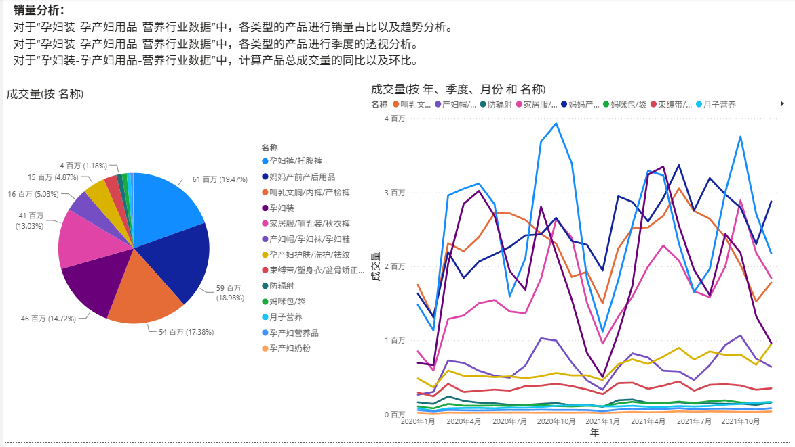
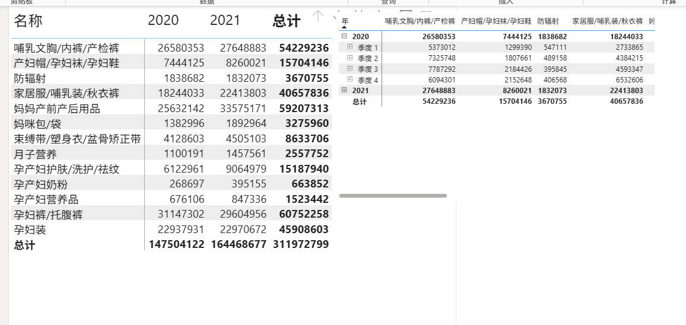
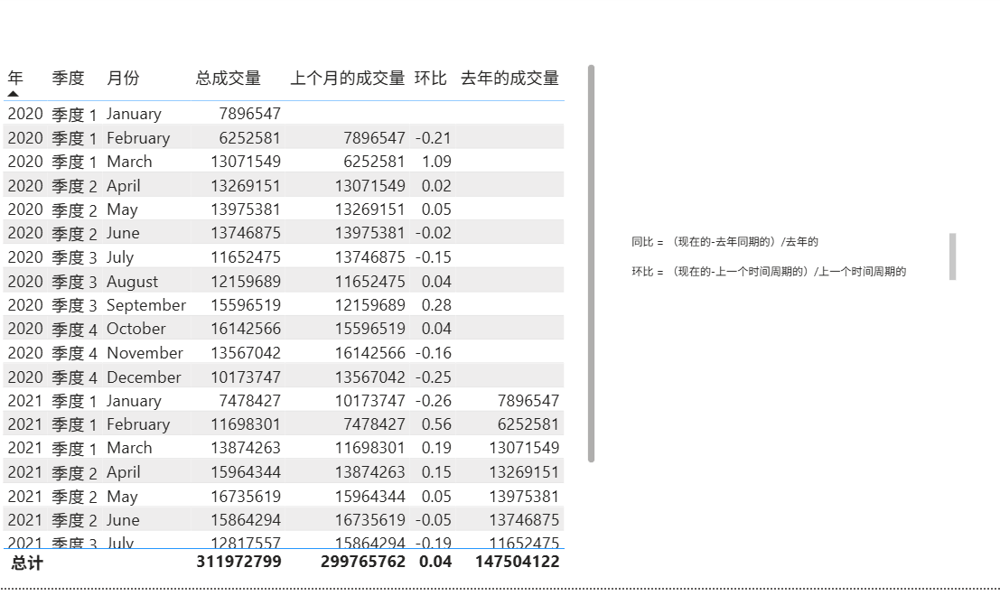
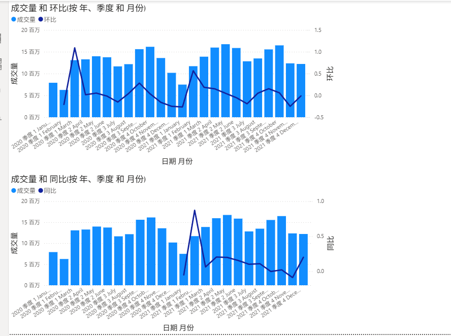
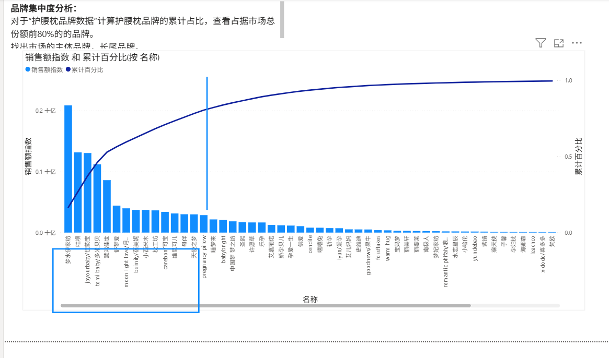
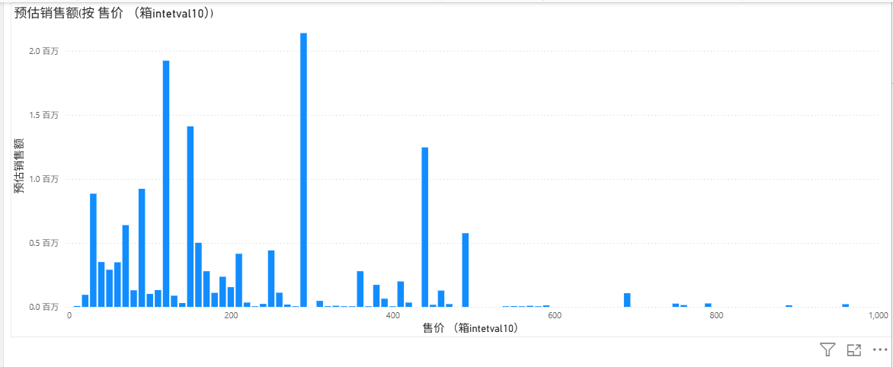

# 母婴产品市场分析（Power BI）

> Maternal & Infant Products Market Analysis — 基于 2020.01–2021.12 电商行业数据的 Power BI 市场分析项目

## 项目简介

以孕产/妈妈人群的电商消费市场为分析对象，围绕三个业务问题展开：**这个市场有多大、还在不在涨？钱集中在哪些品类、哪些品牌？什么价格带最好卖？**

对 5 张行业数据表完成导入、建模、指标构建与可视化，输出一份包含销量分析、同比环比、品牌集中度、价格带分布四大模块的 Power BI 分析报告。

## 数据集说明

| 文件 | 规模 | 内容 |
|---|---|---|
| 孕妇装-孕产妇用品-营养行业数据 | 13 品类 × 24 个月，312 条 | 行业级销量与销售额指数 |
| 妈妈产前产后用品行业数据 | 21 品类 × 24 个月，504 条 | 子行业销量与销售额指数 |
| 护腰枕品牌数据 | 62 个品牌 × 24 个月，506 条 | 品牌级销售额 |
| 护腰枕属性数据 | 尺码/可拆洗/颜色等维度，584 条 | 属性级销量 |
| 孕妇枕搜索数据 | 2,198 行 × 40 字段，2,155 个宝贝 | 搜索结果快照（售价、预估销售额等） |

时间范围：2020.01–2021.12；搜索快照抓取于 2022.02（横截面数据，仅用于价格带分析）。

## 分析内容与核心结论

### 1. 品类销量分析



13 个品类 24 个月总成交量 **3.12 亿件**；前五大品类（孕妇裤/托腹裤 19.5%、妈妈产前产后用品 19.0%、哺乳文胸 17.4%、家居服 14.7%、孕产妇护肤 13.0%）合计约占 **84%**。「月子营养」等小品类呈脉冲式尖峰，销量由爆品或大促驱动，与服装类目的平稳节奏完全不同。

### 2. 季度透视



按年/季度逐层下钻核对每个品类的分季成交量：2020 年 1.475 亿 → 2021 年 1.645 亿，**同比增长 11.5%**，市场处于扩张通道。

### 3. 同比环比分析



用 DAX 时间平移度量值构建「上个月成交量、环比、去年同期」，把绝对值与增速放在同一画面对照：全期总环比 +4%，单月环比在 -26% ~ +109% 之间大幅震荡。



### 4. 品牌集中度分析



62 个护腰枕品牌按销售额降序排列并叠加累计占比折线（帕累托图），头部少数品牌累计占比逼近 **80%**，市场呈典型二八格局；长尾品牌数量多但份额薄。

### 5. 价格带分布



对 2,155 个在售宝贝的售价分箱并统计各价格带的预估销售额：销售额集中在 0~450 元，**约 91% 的销售额来自 450 元以下**，主力价格带在中低档；500 元以上体量骤减。

## 技术栈

`Power BI Desktop` · `Power Query`（数据清洗与建模）· `DAX`（同比/环比/时间平移度量值）· `日期层级`（年-季度-月份）

## 项目结构

```
├── 母婴产品市场分析.pbix     # Power BI 分析报告（源文件）
├── data/                     # 5 张原始数据表
├── screenshots/              # 报告各页截图
└── README.md
```

## 如何查看

1. 下载 `母婴产品市场分析.pbix`，用 [Power BI Desktop](https://www.microsoft.com/zh-cn/download/details.aspx?id=58494)（免费）打开即可交互查看；
2. 或直接浏览上方截图与结论。

## 备注

- 数据来自课程提供的公开电商行业数据，仅用于学习与分析练习；
- 搜索快照为单日横截面数据，不用于趋势推断。
